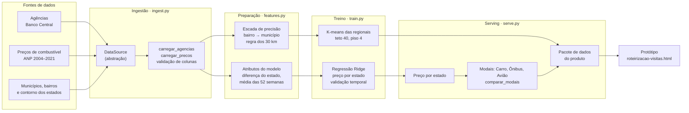
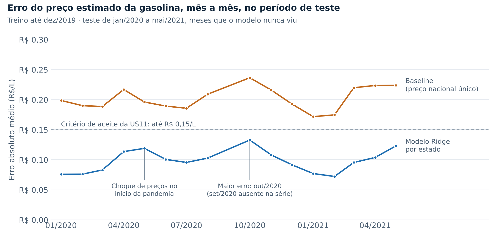

# Arquitetura e SOLID

Checkpoint das Aulas 4, 5 e 6 · Parte 2 — Arquitetura e SOLID

## 1. Arquitetura de referência

O pipeline segue os três estágios da Aula 5 — ingestão, treino e serving — com
um estágio de preparação entre a ingestão e o treino. Cada estágio é um módulo
com uma única responsabilidade, e o `pipeline.py` é o único lugar que conhece as
fontes concretas.



| Estágio | Módulo | Quando roda | Entra | Sai |
| --- | --- | --- | --- | --- |
| Ingestão | `src/ingest.py` | A cada nova publicação do Bacen ou da ANP | Arquivos brutos | Tabelas validadas |
| Preparação | `src/features.py` | Junto da ingestão | Tabelas validadas | Coordenadas e atributos |
| Treino | `src/train.py` | Por sprint, ou quando a série de preços é atualizada | Atributos | Regionais e modelo de preço, com métricas |
| Serving | `src/serve.py` | A cada planejamento | Modelos e tabelas | Custo, tempo e modal por trecho; pacote do produto |
| Orquestração | `src/pipeline.py` | Sob demanda | Caminhos das fontes | Tudo acima, de ponta a ponta |

## 2. Do backlog aos módulos

| Story | Onde é implementada | Teste |
| --- | --- | --- |
| US01 · Selecionar agências da regional | `train.treinar_regionais` forma as regionais; o produto filtra | `test_train.py` |
| US03 · Escolher o objetivo | `serve.comparar_modais(peso_custo=...)` | `test_serve.py` |
| US05 · Modal por trecho | `serve.Carro`, `serve.Onibus`, `serve.Aviao` | `test_serve.py` |
| US06 · Detalhe do trecho | `serve.comparar_modais` devolve as três opções e o motivo | `test_serve.py` |
| US10 · Agências no lugar certo | `ingest.carregar_agencias`, `features.enriquecer_coordenadas` | `test_ingest.py`, `test_features.py` |
| US11 · Preço do combustível por estado | `features.atributos_preco`, `train.RegressaoEstado`, `serve.precos_por_uf` | `test_train.py` |

As stories de interface (US02, US04, US07, US08, US09) vivem no protótipo, em
`produto/fonte/`.

## 3. Princípios SOLID aplicados

SOLID são cinco princípios de design de código: **S**ingle Responsibility,
**O**pen/Closed, **L**iskov Substitution, **I**nterface Segregation e
**D**ependency Inversion.

| Princípio | Onde | Problema que resolveu |
| --- | --- | --- |
| **Responsabilidade única (SRP)** | `ingest`, `features`, `train` e `serve` como módulos separados | Antes, cada script numerado (`01_` a `05_`) misturava leitura de arquivo, transformação e cálculo. Mudar o formato do Excel do Bacen obrigava a mexer no mesmo arquivo que formava as regionais. Agora uma mudança de fonte toca só o `ingest.py` |
| **Aberto/Fechado (OCP)** | Classe `Modal` em `serve.py`; classe `EstimadorPreco` em `train.py` | Incluir um meio de transporte, como trem, ou um modelo de preço novo, é escrever uma classe nova. `comparar_modais` e `treinar_modelo_preco` não mudam. O teste `test_modal_novo_entra_sem_alterar_codigo_existente` prova isso |
| **Substituição de Liskov (LSP)** | `BaselineNacional`, `EfeitoMedioEstado` e `RegressaoEstado` | Os três estimadores são intercambiáveis. O treino avalia os três com a mesma função e escolhe o de menor erro, sem `if` por tipo de modelo |
| **Segregação de interface (ISP)** | `DataSource` só tem `load()`; `EstimadorPreco` só tem `ajustar()` e `prever()`; `Modal` só tem `estimar()` | Quem implementa uma fonte de dados não é obrigado a implementar nada de modelo, e vice-versa. As interfaces são pequenas o bastante para um teste criar uma implementação falsa em três linhas |
| **Inversão de dependência (DIP)** | `DataSource` em `ingest.py`; `Carro` recebe o preço por estado em vez de um número fixo | O código de carga e de treino não sabe se o dado vem de Excel, TSV, API ou memória. Os testes de ingestão rodam com `MemorySource`, sem nenhum arquivo em disco. Só o `pipeline.py` escolhe as fontes concretas |

### O exemplo de Inversão de Dependência pedido na Aula 5

```python
# ingest.py — a abstração
class DataSource(ABC):
    @abstractmethod
    def load(self) -> pd.DataFrame: ...

# a carga depende da abstração, não do Excel
def carregar_agencias(fonte: DataSource, instituicao=...):
    df = limpar_texto(fonte.load())
    ...

# pipeline.py — o único lugar que conhece a fonte concreta
carregar_agencias(ExcelSource("base_consolidada.xlsx", "Agencias_Geocodificadas"))

# tests/test_ingest.py — mesma função, outra fonte, sem arquivo
carregar_agencias(MemorySource(pd.DataFrame([...])))
```

Trocar a planilha por uma API do Banco Central exige escrever uma classe
`ApiBacenSource` e mudar uma linha do `pipeline.py`. Nada no treino ou no
serving é alterado.

## 4. A refatoração preservou o comportamento

A Aula 5 pede que o pipeline refatorado produza a mesma saída da versão
anterior. Para separar o efeito da reorganização do efeito das correções, o
código novo foi rodado com os dois defeitos antigos reativados:

| Indicador | Versão anterior | Código novo, defeitos reativados |
| --- | --- | --- |
| Agências | 2.040 | 2.040 |
| Regionais | 106 | 106 |
| Agências por regional (mediana / mín / máx) | 16 / 4 / 40 | 16 / 4 / 40 |
| Coordenada de bairro / aproximada / município | 72,0% / 2,8% / 25,2% | 72,0% / 2,8% / 25,2% |

Resultado idêntico. Toda diferença na versão final vem das duas correções
abaixo, encontradas durante a refatoração.

## 5. Defeitos encontrados na refatoração

| Defeito | Efeito | Correção |
| --- | --- | --- |
| Filtro de instituição por trecho de texto (`"ITA"`) | Entravam 30 registros que não são agências do Itaú, como corretoras com "CAPITAL" no nome | Filtro pelo nome exato "ITAÚ UNIBANCO S.A." — 2.010 agências |
| Regra de abreviação sem limite de palavra | "SANTA CATARINA" virava "SAO ANTA CATARINA" e "VILA" virava "VILA ILA" | Abreviação só expandida quando é palavra inteira; teste em `test_features.py` |

**Limitação encontrada na revisão do PR #15 — a regra dos 30 km.** O teste de
sensibilidade mostra que 30 km é o ponto de equilíbrio entre descartar colisões
e manter bairros legítimos:

| Desvio máximo | Descartadas | Agências com coordenada de bairro |
| --- | --- | --- |
| 10 km | 511 | 63,7% |
| 20 km | 336 | 72,4% |
| **30 km (adotado)** | **290** | **74,7%** |
| 50 km | 255 | 76,5% |
| 100 km | 215 | 78,5% |
| sem limite | 0 | 89,2% (inclui colisões, como Mirandópolis a 530 km) |

Mas um limite único não serve para municípios muito extensos: dez agências do
Rio de Janeiro, em bairros da Zona Oeste a 37–50 km do centro, são descartadas
mesmo estando certas. Elas caem para a coordenada do município, o que é
conservador, não errado. A correção — limite proporcional à extensão de cada
município — está registrada na Issue #16 e entra na Sprint 2, junto do risco R1.

Números da versão final: 2.010 agências, 105 regionais, 74,7% com coordenada de
bairro, 290 coordenadas descartadas pela regra dos 30 km.

## 6. Modelo supervisionado (US11)

| Modelo | MAE (R$/L) | RMSE (R$/L) |
| --- | --- | --- |
| Baseline: preço nacional para todos os estados | 0,199 | 0,267 |
| Nacional + efeito médio do estado | 0,115 | 0,154 |
| **Regressão Ridge da diferença do estado** | **0,095** | **0,129** |

MAE é o erro absoluto médio; RMSE é a raiz do erro quadrático médio, que pesa
mais os erros grandes. Treino até dezembro de 2019 e teste de janeiro de 2020 a
maio de 2021, sem embaralhar as semanas, para o modelo não ver o futuro.



**Sensibilidade ao ponto de corte** (pergunta da revisão do PR #15):

| Corte treino/teste | Baseline | Ridge | Ridge vs baseline |
| --- | --- | --- | --- |
| jan/2019 | 0,196 | 0,085 | −57% |
| **jan/2020 (adotado)** | **0,199** | **0,095** | **−52%** |
| jul/2020 | 0,201 | 0,096 | −52% |

A conclusão não depende do corte. Jan/2020 foi escolhido porque deixa o choque
de preços da pandemia inteiro no teste: é o cenário mais difícil para o modelo,
e o resultado não fica otimista por ter sido medido num período calmo.

O erro cresce no início da pandemia (abril e maio de 2020) e tem o pico em
outubro de 2020. É o drift que a Aula 4 descreve: o modelo foi ajustado num
regime de preços e é avaliado em outro. A série da ANP não tem setembro de 2020.

**Limitação declarada:** a série termina em maio de 2021. O produto aplica a
diferença de cada estado sobre o preço nacional de referência atual (R$ 6,70),
assumindo que a diferença entre estados é mais estável que o nível de preço.
Validar essa premissa com dados recentes é a US14.

## 7. Testes

```bash
python -m pytest tests/ -v
```

23 testes, um arquivo por módulo. Cada critério de aceite que pode ser
verificado no pipeline virou um teste.
